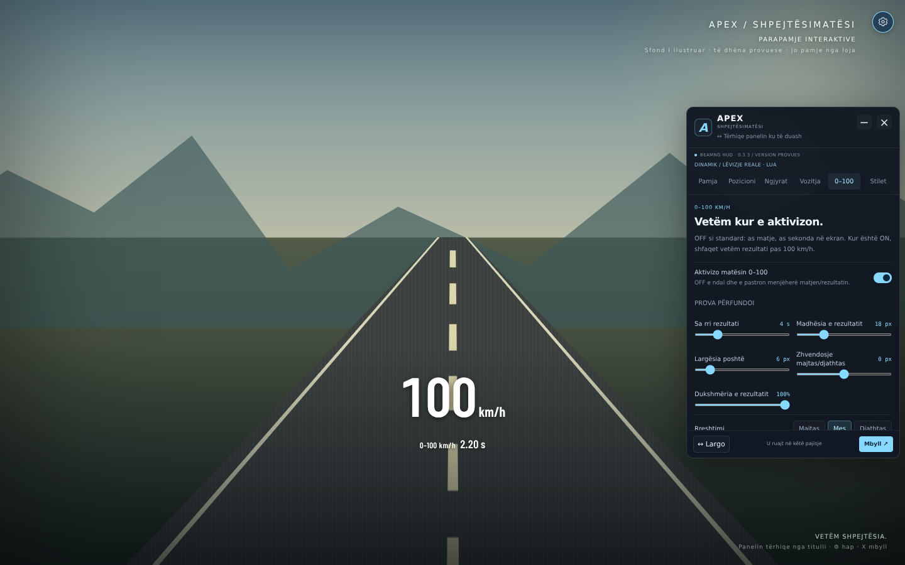

# APEX · Shpejtësimatësi

**v0.3.3 · shqip · target BeamNG.drive 0.39.4**

Speed HUD **numerik**, pa survival, damage apo ndryshime të fizikës së veturës.

## ⬇️ [Shkarko APEX Speedometer 0.3.3 ZIP](https://github.com/p98hh2jtgb-lab/speedometer/raw/refs/heads/arena/c4a2d9cd-speedometer/downloads/apex-speedometer-0.3.3.zip)

**Hiqi / çaktivizoji të gjithë ZIP-at e vjetër APEX. Mbaje vetëm versionin e ri aktiv dhe bëj restart të plotë.** Arkivat e tjerë në `downloads/` janë historikë; mos instalo ZIP-in e gjithë repos.

**Baza vizuale mbetet 0.3.1.** 0.3.2 mbetet e tërhequr dhe ZIP-i i saj nuk shpërndahet. 0.3.3 shton vetëm matësin opsional 0–100 dhe cilësimet e tij; nuk rikthen fontin e rëndë ose ngjyrat e 0.3.2. ZIP-i 0.3.1 mbetet në arkiv për kthim prapa.

## E re: 0–100, OFF si standard

**As sekonda, as matje 0–100 në prapavijë derisa ta aktivizosh vetë.** Nuk ka numërues live gjatë përshpejtimit. Kur e aktivizon dhe përfundon një provë, vetëm atëherë shfaqet p.sh. **`0–100 km/h  2.20 s`**, nën speedometër, për 4 sekonda plus daljen e animuar. Fikja e matësit anulon menjëherë matjen dhe fsheh rezultatin.

**⚙ → 0–100 → Aktivizo matësin 0–100.** Ndalo për së paku 0.5 s, nisu prej vendit dhe arrij 100 km/h. Prova tjetër bëhet gati pas ndaljes, ose pastroje manualisht. Matësi nuk nis nëse e aktivizon ndërsa je duke lëvizur.

### Personalizimi

| Kontrolli | Mundësitë |
| --- | --- |
| Matësi 0–100 | ON / OFF, standard OFF |
| Sa rri rezultati | 1–15 s, standard 4 s |
| Madhësia | 10–40 px, standard 18 px |
| Largësia poshtë / zhvendosja horizontale | 0–48 px / −120 deri +120 px |
| Rreshtimi | Majtas / mes / djathtas |
| Dukshmëria | 20–100% |
| Etiketa `0–100 km/h` | ON / OFF |
| Shifrat pas presjes | 1 / 2 / 3 |
| Ngjyra | Ndjek speedometrin ON/OFF, ose paletë / HEX personale |
| Sfondi / konturi rreth rezultatit | ON / OFF veçmas, standard OFF |
| Animacioni | ON / OFF veçmas; **Fade / Slide / Pop** |
| Shpejtësia e animacionit | 100–900 ms, standard 350 ms |
| Përgatitja automatike pas ndaljes | ON / OFF; buton për pastrim / provë të re |
| Koha e ndaljes para nisjes | 0.2–2 s, standard 0.5 s |

Cilësimet ruhen lokalisht dhe përfshihen në import/eksportin JSON. Nuk ruhen prova të papërfunduara ose rezultate midis sesioneve. **Provo animacionin · 2.20 s** shfaq vetëm shembull të shënuar **PROVË**, jo rezultat të matur. Butoni nuk punon kur matësi është OFF. Animacionet respektojnë `prefers-reduced-motion`.

### Si matet

- Vetëm **lëvizja reale XYZ dhe koha e simulimit `dtSim` nga GE Lua**. Ndërrimi km/h–mph ose smoothing nuk e ndryshon provën: pragu mbetet 100 km/h, edhe në mph. Nuk përdor shpejtësinë e gomave ose orën e browser-it për matje.
- **Pause nuk shton kohë**; slow-motion përdor kohën e simulimit. Vetëm qëndrimi i rezultatit në ekran matet me kohën reale të UI-së.
- Në mungesë të Lua/kohës së simulimit, të dhëna të vjetruara, reset ose ndërrim veture, matja anulohet; nuk shpiket rezultat nga wheelspin/stream-i rezervë. Gjendja shpjegohet vetëm në panel, pa sekonda live në HUD.
- Tolerancë ndaljeje 0.5 km/h, vlerësim i nisjes nga mostrat e para të lëvizjes me ekstrapolim të kufizuar 100 ms dhe interpolim te kalimi i 100. Mostrat janë rreth **20 Hz**, prandaj 2/3 shifrat janë **format shfaqjeje, jo garanci saktësie milisekondash**. Provat mbi 120 s dhe boshllëqet mbi 0.5 s të simulimit anulohen.
- Ky është matës HUD-i për përdorim në lojë, jo pajisje garash e certifikuar. Replay/seek, teleportet pa sinjal reset dhe sjellja e motorit real kërkojnë provë në lojë.

## Pamja clean e 0.3.1, e ruajtur

- **Numra clean**, me Barlow Condensed SemiBold si te versioni para 0.3. Pa font Black 900, pa vijat/dekorimin e rëndë sportiv. Standardi: 88 px, peshë 600, pa pjerrësi.
- **Pa marsh dhe pa RPM**: u hoqën nga HUD-i, cilësimet dhe përpunimi i telemetrisë, jo vetëm u fshehën.
- **Numri dhe km/h gjithmonë bashkë**, në një rresht, shumë afër, me të njëjtën ngjyrë, familje fonti, trashësi dhe pjerrësi. Njësia është ¼ e madhësisë së numrit; madhësia rregullon gjithë instrumentin.
- **E bardhë fikse si standard në çdo shpejtësi.** U hoq spektri shumëngjyrësh dhe pink-u automatik. Paleta/HEX ndryshon gjithë speedometrin menjëherë.
- Opsioni **Kalimi i lehtë**, vetëm nëse e zgjedh vetë: bardhë deri 60 km/h → amber në 100 → e kuqe në 140+. Pragjet mbeten në km/h edhe kur shfaq mph. Asnjë stil nuk e aktivizon automatikisht.
- Përditësimi nga v0.2/v0.3 vendos **një herë** pamjen clean/të bardhë, heq preferencat e vjetra të njësisë së ndarë dhe ruan njësinë, burimin dhe pozicionet e numrit/panelit. Zgjedhjet pas përditësimit ruhen normalisht. Stilet personale mbeten të disponueshme; fushat e hequra injorohen edhe gjatë importit.

## Instalimi

1. Hiqi ose çaktivizoji **të gjitha versionet e vjetra APEX**, përfshirë 0.3.1 dhe versionin e tërhequr 0.3.2.
2. Shkarko `apex-speedometer-0.3.3.zip` nga linku lart.
3. BeamNG Launcher → **Manage User Folder → Open in Explorer**. Qite ZIP-in në `mods` të user folder-it aktiv, **pa e shpaketuar**.
4. Bëj restart të plotë të lojës.
5. Free Roam → **UI Apps → Edit Apps → Add App → APEX · Shpejtësimatësi**. Përdor një instancë, **full screen**, pastaj dil nga editimi.
6. **⚙ sipër djathtas** hap cilësimet; **X** i mbyll. Ky është vetëm butoni i cilësimeve, jo tregues marshi. Nuk ka Ctrl+H dhe nuk ka buton APEX poshtë.
7. Kontrollo **0.3.3** në panel. Nëse shfaq tjetër version, kontrollo ZIP-at aktivë, user folder-in dhe cache-in e UI-së; mund ta heqësh dhe shtosh sërish app-in.

## Përdorimi

- **Panel i vogël, i pavarur**: standard 340 × 560 px. Tërhiq titullin për ta zhvendosur; **− / +** e mbledh/zgjeron. **↔ Largo** zgjedh cepin me më pak mbulim të numrit. Pozicioni dhe madhësia ruhen. Titulli i fokusuar lëviz edhe me shigjeta.
- **Lëviz speedometrin**: Pozicioni → çaktivizo “Blloko numrin” → tërhiq numrin. Paneli nuk lëviz bashkë me të. Të dy mbahen brenda ekranit; në ekran shumë të vogël mbylle/mblidhe panelin për të shmangur mbivendosjen.
- **km/h / mph**: butona direkt, konvertim i menjëhershëm i numrit dhe etiketës. Ose kliko numrin/njësinë. Kur speedometri është i zhbllokuar me panel hapur, drag-u nuk ndërron njësinë.
- **Ngjyra**: paletë ose HEX + Apliko, pa dropdown apo color picker native. Ngjyra fikse aktivizohet menjëherë për numrin **dhe** njësinë.
- **Pamjet**: Clean, Kontur, Racing, Neon, Hyper, Minimal, Digjital. Të gjitha mbajnë numrin/njësinë inline dhe pa marsh/RPM. Neon ka glow blu të lehtë; Hyper sfond dhe zmadhim të butë; Minimal është më i vogël e më i hollë; Digjital është monospaced. Asnjëra nuk ndryshon fizikën.
- Opsione: 0/1/2 decimale, zbutje 0–500 ms, kontur, hije, glow, opacity, sfond, maksimum sesioni, paralajmërim shpejtësie dhe fshehje kur ndalet. Deri 30 stile personale me import/eksport JSON.

## Shpejtësia reale

| Burimi | Sjellja |
| --- | --- |
| **Dinamik** (standard) | Përparësi lëvizjes reale XYZ / Air. Gomat vetëm si rezervë me shënim të dukshëm |
| **Air** | Vetëm lëvizja reale; `—` nëse mungojnë të dhënat, jo zero e shpikur |
| **Gomat** | Vetëm rrotullimi i gomave; mund të tregojë zero gjatë rrëshqitjes me goma të bllokuara |

Matjet vijnë nga `electrics.airspeed` / `airSpeed` dhe një GE Lua bridge i pavarur. “Air” këtu është lëvizja XYZ, përfshirë komponentin vertikal, **jo era**. Mostrat skadojnë pas 1.8 s. Dinamik/Air përdorin lëvizjen reale edhe gjatë frenimit me goma të bllokuara ose wheelspin. Maksimumi pastrohet në reset/ndërrim veture ose manualisht.

## Parapamje dhe teste




```sh
npm ci
npm test
npm run preview                       # terminal tjetër; http://localhost:8080
npm run test:browser                   # Chromium Linux x64
python -m venv .venv
.venv/bin/pip install -r requirements-dev.txt
.venv/bin/python tests/test_lua.py
npm run package
```

Serveri kërkon vetëm Python standard. Slider-i provues shfaqet vetëm në parapamje, jo në lojë. Testet mbulojnë konvertimin, ngjyrat e renderuara, tipografinë e përbashkët në të gjitha stilet, heqjen e marshit/RPM, migrimin nga v0.2/v0.3, drag/persistencën, ekranin e vogël, sjelljen brenda një forme, mostrat që mungojnë dhe frenimin 300 km/h me goma në zero. Matësi i ri testohet për OFF pa llogaritje, mungesë sekondash para përfundimit, interpolim/clock/pause/slow-motion të simuluar, personalizim, animacionet, reduced motion, timeout dhe pastrim.

**v0.3.3 është testuar në browser dhe me API/Lua të simuluara, jo brenda BeamNG 0.39.4.** Këto teste nuk vërtetojnë CEF/input-in e lojës; duhen provuar aty drag-u, njësitë/ngjyrat, frenimi, fluturimi, pause/slow-motion/replay dhe UI scaling.

## Licencat / struktura

`mod/` përmban burimin; ZIP-i ka `lua/`, `ui/` dhe metadata në rrënjë. `downloads/` ka ZIP-at/SHA-256; `preview/`, `scripts/`, `tests/` janë vetëm për zhvillim.

`creatorpack v1.1.zip` dhe `BeamRoyalSpeedHUDMod (1).zip` janë referenca të palëve të treta, jo pjesë e paketës/licencës APEX. Kodi/asetet origjinale APEX janë MIT; kodi, ikonat dhe fonti i referencës nuk kopjohen apo shpërndahen. Fontet **Barlow Condensed** shpërndahen pa ndryshime me SIL OFL te dosja `fonts`. Nuk ka tracking, thirrje rrjeti apo fonte të jashtme në runtime; varësitë npm/Python nuk përfshihen në mod.
