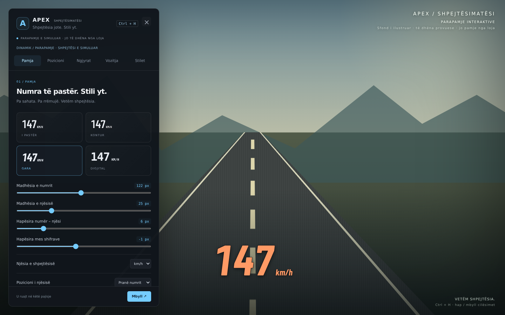

# APEX · Shpejtësimatësi

**v0.2.0 · shqip · target BeamNG.drive 0.39.4**

Speed HUD numerik mbi lojë — jo komplet instrument tabelë. Pa survival, damage, boost apo ndryshime të fizikës.

## ⬇️ [Shkarko APEX Speedometer 0.2.0 ZIP](https://github.com/p98hh2jtgb-lab/speedometer/raw/refs/heads/arena/c4a2d9cd-speedometer/downloads/apex-speedometer-0.2.0.zip)

**Hiqe / çaktivizoje ZIP-in 0.1.0 para instalimit. Mos i mbaj të dy versionet aktive.** Shkarko vetëm ZIP-in e modit, jo gjithë repon me “Download ZIP”. Arkivi i vjetër në `downloads/` është historik.

## Çka u ndryshua në 0.2.0

- Paneli, shpjegimet, njoftimet dhe emrat e stileve janë **shqip**.
- U hoq butoni APEX poshtë ekranit. **Ctrl+H** hap/mbyll panelin përmes një komande native të lojës; ka edhe mbështetje kur UI-ja e merr tastin. Eventet e dyfishta të së njëjtës shtypje filtrohen.
- **Dinamik** është standard. Lexohen direkt `electrics.airspeed` / `airSpeed`, jo vetëm gomat. GE Lua mbetet rrugë e pavarur me matje të shpejtësisë nga komponentët XYZ, pa varësi nga metoda `vec3:length()`.
- **Air** është burim i rreptë i lëvizjes reale; **Gomat** mbetet opsion eksplicit. Në Dinamik, rezerva te gomat shënohet qartë kur të dhënat reale mungojnë.
- Ngjyrat aplikohen direkt te numri/njësia, edhe për `change` events të zgjedhësit të ngjyrës. Ka **paletë dhe fusha HEX**, pa varësi nga hapja e zgjedhësit native të ngjyrës në CEF.
- Zgjedhja e ngjyrës kryesore aktivizon ngjyrën fikse; kalimi sipas shpejtësisë aktivizohet veçmas. Nuk e mbulon më zgjedhjen manuale pa qenë e qartë.
- Font **Barlow Condensed**, i paketuar lokalisht. U hoq gjerësia boshe e detyruar e numrit. `km/h` rri afër dhe ka slider për **hapësirën numër–njësi** dhe **hapësirën mes shifrave**.
- Preferencat e 0.1 përditësohen një herë për të hequr standardin e vjetër “vetëm gomat”, duke ruajtur madhësinë, pozicionin, ngjyrat dhe stilet personale.

## Instalimi / përditësimi

1. Hiqe ose çaktivizoje `apex-speedometer-0.1.0.zip` te Mod Manager / dosja `mods`.
2. Shkarko **`apex-speedometer-0.2.0.zip`** nga linku lart.
3. Te BeamNG Launcher: **Manage User Folder → Open in Explorer**. Vendose ZIP-in në `mods` të user folder-it aktiv, **pa e shpaketuar**.
4. Bëj **restart të plotë të lojës**, përfshirë ngarkimin e komandës së re të tastierës.
5. Në Free Roam me veturë: **UI Apps → Edit Apps → Add App → APEX · Shpejtësimatësi**. Nëse e ke app-in ekzistues, mund të mbetet në layout; nëse s’përditësohet, hiqe dhe shtoje përsëri.
6. Lëre UI app-in **full screen**, pastaj dil nga editimi i UI Apps.
7. Shtyp **Ctrl+H** për panelin. Për zhvendosje: **Pozicioni → çaktivizo “Blloko pozicionin”**, pastaj tërhiqe numrin me maus me panelin hapur.

Nëse Ctrl+H nuk punon ose ka konflikt me një komandë tjetër, te **Settings → Controls** kërko **APEX: Hap / mbyll cilësimet** dhe cakto `Ctrl+H`. Right-click mbi numrin mbetet alternativë, edhe pa buton në ekran.

## Burimi i shpejtësisë

| Zgjedhja | Sjellja |
| --- | --- |
| **Dinamik** (standard) | Përparësi shpejtësisë reale XYZ / Air. Nëse mungon, përdor gomat me shënim `REZERVË: GOMAT`. |
| **Lëvizja reale (Air)** | Vetëm lëvizja reale. Nuk përdor gomat si zëvendësim; në mungesë të dhënash shfaq `—`. |
| **Rrotullimi i gomave** | Vetëm shpejtësia nga gomat. Goma të bllokuara mund të tregojnë 0 edhe nëse vetura rrëshqet; kjo është natyra e këtij burimi. |

Kur vetura lëviz **300 km/h**, por gomat janë në **0**, **Dinamik / Air** vazhdojnë të përdorin lëvizjen reale. Vlen edhe gjatë kërcimit dhe kur gomat rrotullohen më shpejt se vetura. Zero reale është vlerë e vlefshme dhe nuk zëvendësohet me shpejtësinë e gomave.

“Air” këtu është emërtim për lëvizjen reale në botën e lojës, përfshirë komponentin vertikal — **jo matje aerodinamike e erës**. Nëse një stream nuk jep mostra të freskëta brenda 1.8 s, konsiderohet i padisponueshëm. Dinamik nuk bën blend me rrotullimin e gabuar të gomave kur ka të dhëna reale; zbutja e numrit rregullohet veçmas.

## Opsionet

- **I pastër / Kontur / Gara / Digjital**.
- Madhësia e numrit 32–220 px; njësia 10–70 px; ndarje dhe pozicion i pavarur për njësinë.
- km/h / mph, numra të pjerrët, kontur, hije, transparencë, sfond opsional.
- Ngjyrë fikse ose kalim gradual me prag/ngjyrë të mesme dhe të lartë.
- Drag, kapje në qendër, pozicionim në përqindje, mbajtje brenda ekranit.
- Shfaq/fshih HUD-in, fshehje kur ndalet, maksimum sesioni dhe paralajmërim shpejtësie.
- Marsh dhe shirit RPM opsional. Kufiri RPM është **manual**, jo redline i zbuluar automatikisht.
- Pesë stile të gatshme, deri 30 personale, import/eksport JSON dhe ruajtje automatike lokale.

Me panelin hapur HUD-i mbetet i dukshëm për rregullim edhe nëse e ke fshehur. Pragjet janë në njësinë e zgjedhur; ndryshimi km/h → mph **nuk** konverton automatikisht pragjet e ruajtura. Maksimumi pastrohet në reset/ndërrim veture ose manualisht. Rekomandohet një instancë e app-it.

## Parapamje reale e UI-së



Kjo është UI-ja reale në browser, me sfond CSS të ilustruar dhe të dhëna sintetike, **jo screenshot nga BeamNG**.

```sh
npm run preview
# http://localhost:8080
```

Nuk duhen paketa npm për parapamjen; serveri përdor Python standard. Te **Vozitja → Shpejtësia provuese** mund ta provosh ngjyrën në shpejtësi të ndryshme.

## Testet / zhvillimi

```sh
npm ci
npm test                              # logjika numerike, burimet, migrimi, ngjyrat
npm run preview                       # lëre ndezur në terminal tjetër
npm run test:browser                   # UI + adapter / Ctrl+H; Chromium Linux x64
python -m venv .venv
.venv/bin/pip install -r requirements-dev.txt
.venv/bin/python tests/test_lua.py      # Lua me API të simuluara
npm run package                       # ZIP determinist për instalim
```

Testet përfshijnë **300 km/h me goma në 0 pa Lua bridge**, wheelspin, lëvizje reale zero, Air me të dhëna që mungojnë, shenjimin e rezervës, ngjyrën reale të renderuar, `change`-only color events, madhësitë/hapësirat, migrimin nga v0.1, komandën native Ctrl+H dhe pastrimin e eventeve.

**User-i konfirmoi që v0.1 shfaqej në lojë. Ndryshimet e v0.2 ende kërkojnë test në BeamNG 0.39.4.** Testet e browser-it dhe API-të e simuluara nuk vërtetojnë kompatibilitetin e plotë në lojë. Mbeten për provë: frenimi me goma të bllokuara, fluturimi, pause/slow-motion/replay, Controls binding, kalimi i input-it te loja, UI scaling dhe automjete të modifikuara.

## Struktura / licencat

- `mod/` — burimi i modit, me `lua/`, `ui/`, `settings/` direkt në rrënjën e ZIP-it.
- `downloads/` — versionet ZIP dhe SHA-256.
- `preview/`, `scripts/`, `tests/` — parapamje dhe mjetet zhvillimore; nuk paketohen në mod.
- `creatorpack v1.1.zip` — referencë e pandryshuar e palës së tretë; nuk paketohet.

U analizua edhe **BeamRoyalSpeedHUDMod (1).zip** i shtuar nga përdoruesi në `main`, si referencë për Air/Dynamic dhe komanda native. Kodi, fonti dhe ikonat e tij **nuk kopjohen apo shpërndahen** në APEX.

Kodi dhe asetet origjinale APEX janë MIT. **Barlow Condensed**, shkarkuar nga Google Fonts, shpërndahet pa modifikim me SIL Open Font License: `mod/ui/modules/apps/ApexSpeedometer/fonts/OFL.txt`. Mjetet npm/Python janë vetëm për zhvillim; nuk përfshihen në ZIP. Modi nuk ka kërkesa rrjeti, tracking apo fonte të jashtme në runtime.
